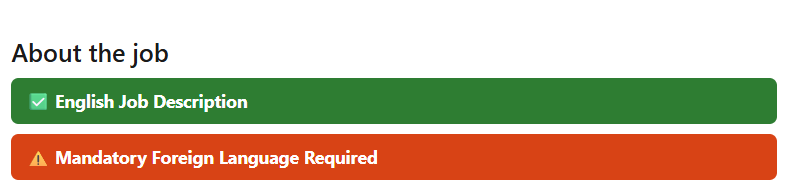
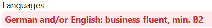
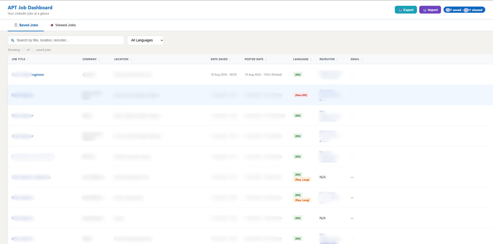
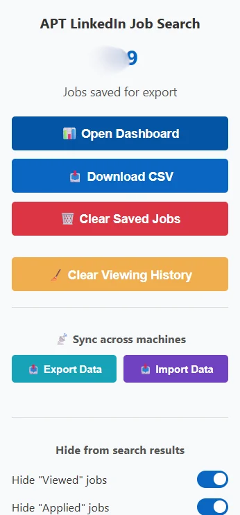

# APT LinkedIn Job Search

A personal Chrome extension that helps job seekers review LinkedIn listings faster by filtering unwanted results and highlighting useful information before they read a full description.

I created and personally own this project. I use it for my own job search, and a couple of friends also use it. It is built with vanilla JavaScript, HTML, CSS, and Chrome Manifest V3. The current browser extension uses regular expressions and local text heuristics, with no AI model or analysis API key required.

## Screenshots

### Job-description signals



Local text rules add language and requirement indicators near the top of an opened description. These signals help prioritize reading; they are estimates, not verified requirements.



The extension also highlights matching requirement text inside the description, so you can inspect the wording behind a warning. In this example, the posting says "German and/or English"; the highlight identifies a possible requirement, but does not establish that German is mandatory.

### Saved and viewed job dashboard



The dashboard brings saved and viewed records together with sorting, search, and language filters. Identifying listing details have been blurred in this screenshot. Date Saved records the extension's save time, not a verified application date.

### Popup controls



Open the dashboard, export records, transfer JSON backups, and change Viewed/Applied visibility from the popup. The count shown is saved job records, not a user or installation count. This capture is cropped at the lower edge of the Applied control.

## Why it is useful

When searching across a broad region, such as the European Union, a result list can include many locations you do not want to consider. This extension adds a country and city blocklist on top of the results already loaded in your browser, helping you focus on relevant locations.

After you open a supported job listing, the extension checks its description and displays signals near the top:

- **Description language:** an estimate of whether the advertisement is written in English.
- **Language requirements:** highlights for wording that may require another language, such as German or Dutch.
- **Work authorization and sponsorship restrictions:** warnings for phrases such as no visa sponsorship or an existing right-to-work requirement.

These checks use local rules rather than model calls, so they do not wait for an AI service. They help you decide which descriptions deserve a closer look. They are heuristics, not guarantees: no warning does not mean that sponsorship is available, and optional or ambiguous requirements can be misclassified.

## Current features

### Filter the results you browse

- Hide cards containing blocked country or city names.
- Choose whether to hide cards LinkedIn marks as **Viewed** or **Applied** using the popup toggles.
- See counts of loaded, hidden, and visible cards.
- Apply the filters as supported cards appear and refresh the list when toggles change.

The location list currently lives in the source code, separately in both content scripts. A popup location editor and location-field matching are planned. At present, matching uses the whole card text, so a title or company containing a blocked location substring can also be hidden.

### Keep a job-search history

The built-in dashboard has **Saved Jobs** and **Viewed Jobs** tabs. Depending on the fields captured for a record, it can show:

- Job title, company, location, and a link to the listing.
- Approximate posted or reposted time.
- Viewed time and extension-saved time.
- Language and requirement indicators.
- Saved description text.
- Recruiter name, email, or profile link when extracted from the listing.

Columns can be sorted, and the dashboard supports text search and language filters. Saved descriptions can be opened without revisiting the listing. Company is displayed and sortable, but company-name text search is not implemented yet.

**Saved is not the same as applied.** Clicking this extension's Save Job button does not submit an application, synchronize LinkedIn's Save action, or record a verified application date. Explicit application-status and date tracking are planned.

### Export and transfer your records

- Download saved jobs as CSV from the popup.
- Export the full job cache as JSON from the popup or dashboard.
- Import JSON to merge records, including when moving between computers.

JSON transfer is manual, not automatic cloud synchronization. Keep exports private and do not import files from untrusted sources.

## Install and use

1. Obtain the repository source.
2. Open `chrome://extensions` in Chrome and enable **Developer mode**.
3. Click **Load unpacked** and select the `job-filter-extension/` folder.
4. Reload any existing LinkedIn jobs tabs after installing or updating the extension.
5. Open a supported job search, inspect the badges on an opened listing, and use the extension's **Save Job** button when you want to retain its details.
6. Open the extension popup for Viewed/Applied toggles, CSV export, JSON transfer, and the dashboard.

The extension needs no build step, npm installation, backend server, or AI credentials. Opening its HTML files as ordinary web pages does not provide the Chrome extension APIs.

To change blocked locations today, edit `countriesToRemove` in both `content.js` and `ai_search_page.js`, then reload the extension and affected tabs. The scripts currently have different default lists, so check both.

Use the source folder as the development version. The checked-in `job-filter-extension.zip` is an older package and differs from the current source; it should be regenerated before a release.

## Data and privacy

### Browser extension

The current extension analyzes page text locally and stores its cache in `chrome.storage.local`. Its source contains no explicit calls to an external analysis API. Normal LinkedIn browsing and opening job or recruiter links still involve the relevant websites.

Viewed records contain job metadata, analysis flags, and timestamps. Saved records can additionally contain full description text, recruiter names/profile links, and email addresses. These can include other people's personal information even when the listing is public and storage is local. CSV and JSON exports retain that information.

**Clear Saved Jobs** removes save-only details while retaining viewed metadata. **Clear Viewing History** removes the full job cache, including saved jobs. Keep backups outside the repository. Do not publish real browsing history, recruiter contacts, messages, or credentials; use invented examples for shared demonstrations and tests.

### Optional Python companion

The separate [`analyze jobs/`](analyze%20jobs/README.md) experiment searches the connected Gmail inbox for messages associated with saved companies, then sends selected email bodies to Google's Gemini API to estimate application status. This part uses external services and has a different privacy boundary from the extension.

It is not required to use the browser extension. The companion README explains configuration, current setup issues, and limitations. Provider availability, pricing, and quotas can change; model-powered features are not guaranteed to be free.

## Project structure

```text
job-filter-extension/
  manifest.json       Extension configuration and permissions
  content.js          Classic LinkedIn jobs interface
  ai_search_page.js   LinkedIn search-results interface
  popup.html / .js    Controls and CSV/JSON transfer
  dashboard.html / .js  Saved and viewed job dashboard
analyze jobs/         Optional Gmail and Gemini companion
test_lang.js          A language-density diagnostic
ROADMAP.md           Planned features and engineering work
LICENSE              MIT license
```

`ai_search_page.js` is named for LinkedIn's search interface. It does not itself call an AI model. Both content scripts currently duplicate some extraction rules and location data.

## Development status

The project is in active personal development. LinkedIn can change its page structure, and the current selectors and Viewed/Applied checks depend on supported layouts and English interface labels.

Known issues being prioritized:

- Re-analysis can replace a saved record and remove its saved details.
- Storage updates across tabs can overwrite newer changes; an open dashboard can become stale.
- Imported records need stronger validation and safe text/link rendering.
- URL parsing, reused cards, language detection, and sponsorship warnings need regression coverage.

See [ROADMAP.md](ROADMAP.md) for the feature direction, proposed milestones, and completion criteria.

The root package files declare `cheerio` and `jsdom`, but there is no configured npm test command. `test_lang.js` prints statistics for one sample rather than asserting correctness. Basic checks with Node.js are:

```sh
node --check job-filter-extension/content.js
node --check job-filter-extension/ai_search_page.js
node --check job-filter-extension/popup.js
node --check job-filter-extension/dashboard.js
node test_lang.js
```

These checks do not replace browser testing. A fixture-based regression suite and CI are planned.

## License

The original project code is licensed under [MIT](LICENSE). Copyright (c) 2026 Adel (Adelapt98). This license does not grant rights to third-party job descriptions, personal data, trademarks, or logos.
